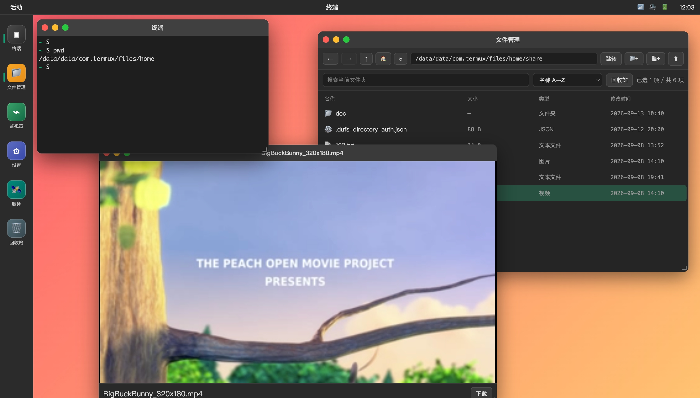

# Termux Web Desktop

在浏览器中模拟 Ubuntu 桌面，终端命令在宿主机真实执行，文件管理操作真实文件系统。支持 Android Termux 与标准 Linux。



## 功能

- **终端**：基于 xterm.js + WebSocket + PTY，真实执行宿主机命令
- **文件管理**：浏览、新建、删除（回收站）、重命名、复制、移动、上传、下载、文本编辑、媒体预览、从当前目录打开终端
- **活动监视器**：只读查看 CPU / 内存 / 存储 / 网络 / 温度 / 电池与当前用户可见进程
- **设置**：主题色 / 壁纸切换（本地持久化）、当前会话与退出登录、设备与服务信息
- **服务管理**：白名单式管理常驻服务（dufs / sshd 等），一键启动 / 停止 / 重启，实时状态
- **桌面环境**：Ubuntu 风格，可拖拽/缩放/最小化/最大化窗口，左侧 Dock

## 安装与运行

### 初始化脚本（推荐）

```bash
chmod +x start.sh run.sh
./start.sh
./run.sh start
```

脚本会检测 Termux 或标准 Linux、创建项目内的 `.venv`、安装 Python 依赖并交互式生成 `auth.env`。

标准 Linux 需要 Bash、Python 3 和 venv 模块。若系统尚未安装，可先执行对应命令：

```bash
# Debian / Ubuntu
sudo apt-get update
sudo apt-get install -y python3 python3-venv

# Fedora
sudo dnf install -y python3
```

Termux 缺少 Python 时，初始化脚本会自动执行：

```bash
pkg install python
```

启动后在浏览器访问：
- 本机：`http://localhost:5000`
- 同局域网设备：`http://<设备IP>:5000`

常用管理命令：

```bash
./run.sh start
./run.sh status
./run.sh restart
./run.sh stop
```

## Termux 后台保活

```bash
# 防止 CPU 休眠
termux-wake-lock

# 关闭电池优化（Android 设置中操作）
# 设置 → 应用 → Termux → 电池 → 无限制
```

## Termux 开机自启动

依赖 [Termux:Boot](https://github.com/termux/termux-boot)（与主 Termux 同来源，如 F-Droid）。配置一次即可：

```bash
# 1. 安装 Termux:Boot 后，先手动打开它一次（授予开机自启动权限）
# 2. 在项目目录生成启动项
./run.sh enable-autostart

# 查看状态 / 关闭
./run.sh autostart-status
./run.sh disable-autostart
```

`enable-autostart` 会在 `~/.termux/boot/termux-web-desktop` 写入启动脚本：开机延迟 10 秒后调用 `./run.sh start`，日志记录到 `boot.log`。同时建议关闭 Termux 的电池优化（见上），确保后台不被系统杀掉。

> 若未安装 Termux:Boot 或从未打开过它，启动项不会在开机时执行——命令会给出对应提示。

## 标准 Linux 开机自启动

`run.sh` 的 `enable-autostart` 等命令只管理 Termux:Boot。标准 Linux 建议交给 systemd 等系统服务管理器。

以下是 systemd 用户服务示例。先将其中的 `/absolute/path/termux-web-desktop` 替换为项目绝对路径：

```ini
# ~/.config/systemd/user/termux-web-desktop.service
[Unit]
Description=Termux Web Desktop
After=network.target

[Service]
Type=forking
WorkingDirectory=/absolute/path/termux-web-desktop
PIDFile=/absolute/path/termux-web-desktop/server.pid
ExecStart=/absolute/path/termux-web-desktop/run.sh start
ExecStop=/absolute/path/termux-web-desktop/run.sh stop
Restart=on-failure
RestartSec=5

[Install]
WantedBy=default.target
```

启用服务：

```bash
systemctl --user daemon-reload
systemctl --user enable --now termux-web-desktop

# 如需用户未登录时也在开机后启动
sudo loginctl enable-linger "$USER"
```

### 一并托管其它常驻服务（如 sshd）

`~/.termux/boot/` 下每个可执行脚本都会在开机时被 Termux:Boot 逐个执行，因此可以把 sshd 等服务也放进来，统一由开机钩子拉起——这比写在 `~/.bashrc` 里的“登录才触发”更可靠（后者要有人打开 Termux 或 SSH 连入才会执行，手机冷重启后无人登录则不会启动）。

例如新增一个 sshd 启动项：

```bash
cat > ~/.termux/boot/sshd <<'EOF'
#!/data/data/com.termux/files/usr/bin/bash
termux-wake-lock
sshd
EOF
chmod 700 ~/.termux/boot/sshd
```

要点：

- 每个脚本首行写 shebang `#!/data/data/com.termux/files/usr/bin/bash`，并 `chmod 700`。
- 脚本应幂等（重复执行不重复起进程）。`sshd` 自身若已监听则不会再起；本项目的 `run.sh start` 已内置运行检测。
- 开机脚本里 `termux-wake-lock` 可防止 CPU 休眠导致服务被挂起。
- 迁移后记得从 `~/.bashrc` 删除对应的登录启动片段，避免重复维护。

> dufs 已作为本项目的集成服务由“服务管理”面板统一启停（见下文），无需再单独放入 `~/.termux/boot/`。

## 项目结构

```
termux-web-desktop/
├── server.py              # Flask 后端（PTY + 文件 API + 系统指标/信息 + 日志轮转）
├── requirements.txt
├── start.sh               # 首次安装：创建 .venv、装依赖并生成登录凭据
├── run.sh                 # 双平台运行管理：后台 start / stop / restart / status
├── auth.env.example       # 凭据模板（复制为 auth.env 并填入真实值）
└── static/
    ├── index.html         # 桌面主页面
    ├── css/style.css      # Ubuntu 风格样式（:root 主题变量）
    └── js/
        ├── desktop.js         # 窗口管理系统
        ├── terminal.js        # 终端应用
        ├── filemanager.js     # 文件管理器应用
        ├── activitymonitor.js # 活动监视器应用
        ├── settings.js        # 设置应用（外观/会话/关于）
        ├── services.js        # 服务管理应用（白名单启停）
        └── integration_dufs.js # dufs 集成配置页（安装 + 可视化配置）
```

## 登录鉴权

推荐直接运行 `./start.sh`，它会交互式地询问用户名/密码，自动生成密码哈希与会话密钥并写入 `auth.env`（权限 600）。

如需手动生成（例如脚本化部署）：

```bash
cp auth.env.example auth.env
# 生成密码哈希
.venv/bin/python -c "from werkzeug.security import generate_password_hash as g; print(g('你的密码', method='pbkdf2:sha256:600000'))"
# 生成会话密钥
.venv/bin/python -c "import secrets; print(secrets.token_hex(32))"
# 将上面两个值填入 auth.env 的 WEB_PASSWORD_HASH 与 SESSION_SECRET
./run.sh start
```

> `auth.env` 含密钥，已在 `.gitignore` 中忽略，请勿提交或外发。

## 日志

`server.log` 采用轮转策略（默认单文件 2MB、保留 3 份），可用环境变量覆盖：
`LOG_FILE` / `LOG_MAX_BYTES` / `LOG_BACKUP_COUNT`。

## 服务管理

“服务管理”应用可对**白名单内**的常驻服务执行启动 / 停止 / 重启。
白名单定义在项目根目录的 `services.json`（首次运行自动生成，各设备自行定制，不纳入版本控制）：

```json
[
  { "id": "dufs", "name": "dufs 文件服务", "description": "轻量文件分享",
    "port": 3001, "match": "dufs", "start": "dufs -p 3001 --allow-all ~/share" }
]
```

- `match`：用于 `pgrep -f` 匹配进程的命令行子串
- `port`：用于判断运行状态的监听端口（可选）
- `start`：启动命令（留空则该服务只读，不显示启动按钮）
- `self: true`：标记本 Web 服务自身，只读、禁止通过面板启停（避免自杀）

> 面板仅能操作白名单内服务，不提供任意进程管理，安全可控。

## dufs 集成（文件服务）

在“服务管理”中点击 dufs 卡片的 **配置** 按钮，打开可视化集成配置页。适合把本项目分发给其它用户后，让他们**从零部署并按需配置** dufs：

- **一键安装**：检测本机是否已装 dufs；未装时从源码仓库用 `cargo` 编译安装（进度实时显示、后台进行）。
  - **Termux 依赖自动补齐**：点击安装时会自动执行 `pkg install -y rust git`。标准 Linux 不会自动执行 `sudo`；需先通过系统包管理器安装 cargo/rustc 与 git。
  - dufs 使用纯 Rust 的 rustls，不依赖系统 OpenSSL/C 库额外配置。
  - 安装源可用环境变量覆盖：`DUFS_REPO`（默认 `https://github.com/gengwenguan/dufs`）、`DUFS_BRANCH`（默认 `main`）
  - 首次编译在手机上较慢（可能十几分钟），期间可关闭窗口，安装在后台继续。
- **可视化配置**：共享目录、端口、绑定地址、权限模式（只读 / 上传 / 上传+删除 / 完全控制 / 自定义细粒度）、
  访问密码（`--auth`）、**每目录独立 URL 密码（fork 特色 `--directory-auth`）**、SPA、CORS、HTTPS(TLS) 等，
  并**实时预览生成的启动命令**。
- 提供“局域网只读 / 带密码可上传 / 每目录独立密码 / 完全控制”等**预设方案**一键套用。
- 保存后配置写入 `dufs.json`，并自动同步为服务白名单里的 dufs 启动命令；“保存并启动”可直接拉起。

> `dufs.json` 为设备本地配置，不纳入版本控制。

## 注意事项

- 终端使用 CDN 加载 xterm.js，首次运行需要联网
- 标准 Linux 默认监听 `0.0.0.0:5000`；Termux 默认监听 `:::5000`。请勿直接暴露到不可信网络
- 文件管理只能访问当前用户家目录；普通删除会移入应用回收站，清空回收站后不可恢复
